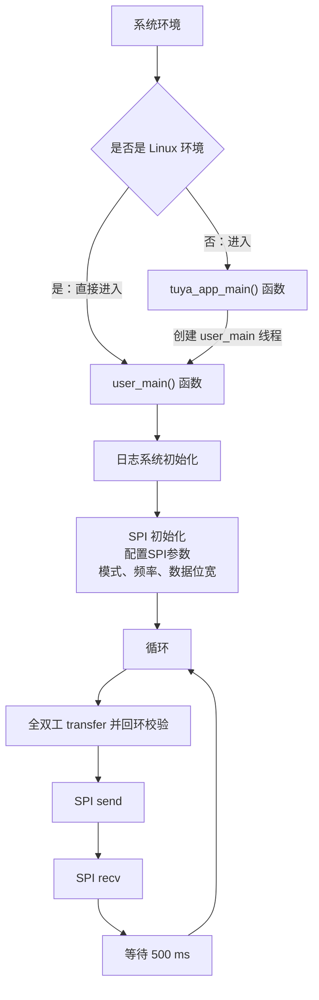

# SPI 串行外设接口

SPI（Serial Peripheral Interface）即串行外设接口，是一种**高速、全双工、同步**的串行通信协议。SPI 使用四根信号线（SCLK时钟线、MOSI主出从入、MISO主入从出、CS片选信号）实现主从设备间的数据传输。

本示例的代码主要向您演示模组作为主机通过 SPI 接口发送数据的功能。关于 SPI 接口的详细说明请查看: [TKL_SPI](https://www.tuyaopen.ai/zh/docs/tkl-api/tkl_spi)。

## 使用指导

### 前置条件

由于每个开发平台上的资源不一样，并不会支持所有外设。
在编译运行该示例代码前，您需要检查 `board/<目标开发平台，如 T5AI>/TKL_Kconfig` 中确认使能配置是否默认打开：

```
config ENABLE_SPI
    bool
    default y
```

在运行本示例工程前要确认基础的 [环境搭建](https://www.tuyaopen.ai/zh/docs/quick-start/enviroment-setup) 已经完成。

### 选择配置文件

在编译示例工程之前需要根据自己的目标开发平台选择对应的配置文件。

- 进入本示例工程目录（假设当前路径是在 TuyaOpen 仓库的根目录下）, 请执行以下命令：

  ```shell
  cd examples/peripherals/spi
  ```

- 进入选择配置文件的菜单，请执行以下命令：

  ```shell
  tos.py config choice
  ```

  命令执行完成后，终端会显示类似以下界面：

  ```
  --------------------
  1. BK7231X.config
  2. ESP32-C3.config
  3. ESP32-S3.config
  4. ESP32.config
  5. EWT103-W15.config
  6. LN882H.config
  7. T2.config
  8. T3.config
  9. T5AI.config
  10. Ubuntu.config
  --------------------
  Input "q" to exit.
  Choice config file: 
  ```

- 根据目标开发平台输入对应配置文件的编号然后按回车键。如选择 T5AI 平台，请输入数字 "9" 后回车键，终端会显示以下界面：

  ```shell
  Choice config file: 9
  [INFO]: Initialing using.config ...
  [NOTE]: Choice config: /home/share/samba/TuyaOpen/boards/T5AI/config/T5AI.config
  ```

### 运行准备

- **参数配置**

  SPI 端口、目标频率、异步 IRQ 和 DMA 可通过 Kconfig（`./Kconfig`）配置。引脚映射由板级 `board_register_hardware()` 完成；TKL 驱动同时内置 START 默认 SPI3 引脚：CS=PE11、CLK=PE12、MISO=PE13、MOSI=PE14。例程不再包含 pinmux 配置或调用。

  - 进入 Kconfig 配置菜单界面， 请执行以下命令：

    ```
    tos.py config menu
    ```

    命令执行完成后，终端会显示类似以下界面：

    ```
    configure project  --->
    Application config  --->
    Choice a board (T5AI)  --->
    configure tuyaopen  --->
    ```

  - 按上下方向键选择子菜单，选择应用配置子菜单 ( Application config ) 按回车键进入。

    进入应用配置的菜单后，终端会显示类似以下界面：

    ```shell
    (0) spi port
    (1000000) spi baudrate
    use asynchronous SPI IRQ mode
    use SPI DMA mode
    ```
    
    工程会给定一个默认参数，如果您想修改配置可以按上下键选修改项，选定后按回车键可进行修改，修改完成后按Q键和Y键保存退出。
  
- **硬件连接**

  GD32H779V_START 默认使用 SPI3：PE11（GPIO ID 75）为硬件 NSS/CS、PE12（ID 76）为 SCK、PE14（ID 78）为 MOSI、PE13（ID 77）为 MISO。做回环验证时，将 MOSI 与 MISO 短接；这里列的是测试信号连接，不代表板载器件或连接器针脚。其他开发板通过自己的 `board_register_hardware()` 配置对应引脚。

  程序使用 Mode 0、MSB 优先、8 bit、硬件 NSS/CS 低有效。每 500 ms 依次执行全双工 transfer、send 和 receive，每笔长度均为 16 字节。短接 MOSI/MISO 时，transfer 收到的数据应为 `Hello Tuya SPI!\0`；receive 操作仅验证调用成功/IRQ 完成，并记录首字节，不假定公共 API 的 dummy 发送填充值。全双工 transfer 的数据比较通过才报告 PASS，错误时报告返回码或首个错误字节。每笔交易预期 128 个时钟，NSS 在传输期间保持低并在结束后恢复高。配置频率是目标值，实际频率可能受硬件分频量化影响，应以分析仪测量为准。

  IRQ 选项关闭时三个操作均为阻塞调用。启用时，程序注册并启用 SPI IRQ 回调，等待各操作对应的完成事件后再检查接收数据；回调只记录事件，不执行日志或 RTOS 操作。

DMA 选项启用后，8 bit 数据使用 GD32 DMA 单数据模式搬运；同时启用 IRQ 时由 SPI 结束中断通知 `TRANSFER_COMPLETE`、`TX_COMPLETE` 或 `RX_COMPLETE`，未启用 IRQ 时为阻塞 DMA。DMA 单次上限为 65535 字节，超过时分块。当前回环用例固定 16 字节，因此会实际覆盖 DMA 路径。

### 编译烧录

- 编译工程，请执行以下指令：

  ```
  tos.py build
  ```

  工程编译成功后，终端会出现类似以下界面:

  ```
  [NOTE]: 
  ====================[ BUILD SUCCESS ]===================
   Target    : spi_QIO_1.0.0.bin
   Output    : /home/share/samba/TuyaOpen/examples/peripherals/spi/dist/spi_1.0.0
   Platform  : GD32H77X
   Chip      : GD32H779VW
   Board     : GD32H779V_START
   Framework : base
  ========================================================
  ```

- 烧录固件，请执行以下指令：

  ```
  tos.py flash
  ```

### 运行结果

- 查看日志，请执行以下指令：

  ```shell
  tos.py monitor
  ```

​	如果烧录和查看日志的步骤出现问题，请阅读 [烧录和日志](https://www.tuyaopen.ai/zh/docs/quick-start/firmware-burning) 。

- 如果程序运行正常，会打印类似如下日志：

  ```
  [01-01 00:00:01 ty N][example_spi.c:xx] spi transfer loopback PASS, length=11
  [01-01 00:00:01 ty N][example_spi.c:xx] spi send PASS, length=11
  [01-01 00:00:01 ty N][example_spi.c:xx] spi receive complete, length=11, first=0xNN
  ```


- 如果SPI各个引脚接上逻辑分析仪，可看到类似如下时序图：

  

## 示例说明

### 流程图



### 流程说明

1. 系统初始化：如果是 Linux 环境，直接调用 user_main()。其他环境则进入 tuya_app_main() 创建 user_main() 线程。
2. 调用 tal_log_init() 初始化日志系统。
3. 配置 SPI 的模式，频率， 数据位宽等参数并初始化。
4. 循环执行全双工 transfer、send 和 recv；启用 IRQ 时分别等待 `TRANSFER_COMPLETE`、`TX_COMPLETE` 和 `RX_COMPLETE`。
5. 全双工 transfer 与发送缓冲做数据比较，通过后打印 PASS；完成后等待 500 ms 进入下一轮。

## 技术支持

您可以通过以下方法获得涂鸦的支持:

- TuyaOpen：https://www.tuyaopen.ai/zh

- GitHub：https://github.com/tuya/TuyaOpen
